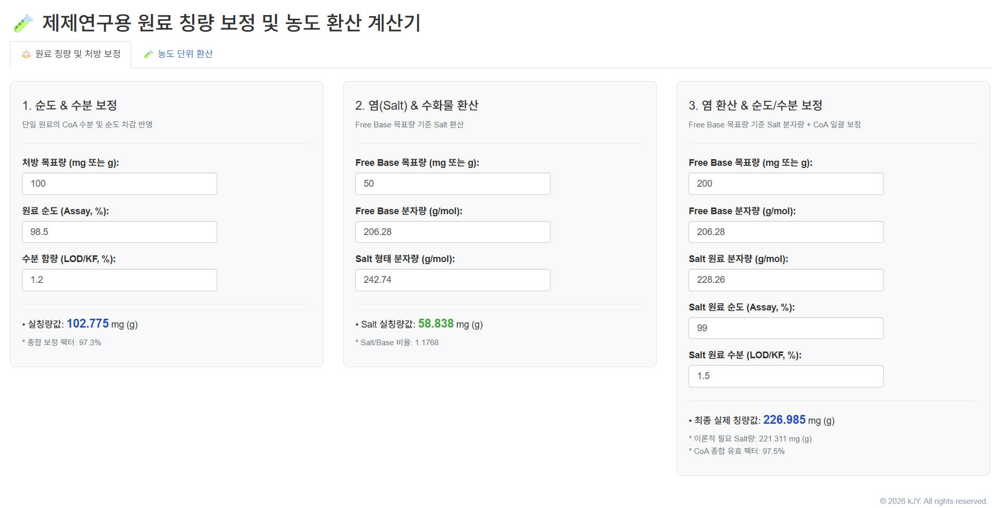
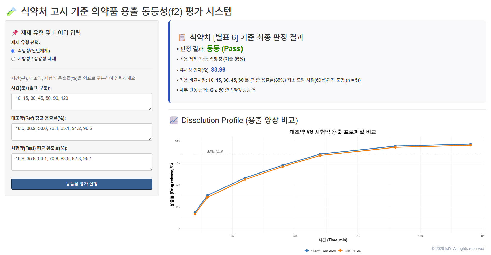
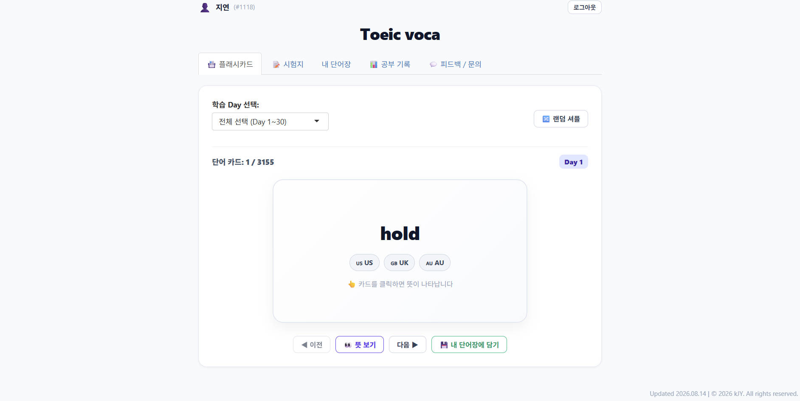

::: {.callout-note appearance="simple"}
**English Version** \| [Korean Version (한국어)](hobbies_ko.qmd)
:::

## 🌟 Beyond the Lab: Things I Enjoy

Outside the lab, I enjoy following motorsports, building websites, and trying new baking recipes. These interests started in different ways, but they all reflect something I enjoy: learning how things work and trying things out for myself.

---

## 🏎️ Motorsports & Formula 1

- **Inspiration & Scientific Connection:**\
  While studying **Computational Fluid Dynamics (CFD)** for pharmaceutical process simulations and powder flow research, I became interested in Formula 1 and the role of aerodynamics in racing. I was particularly fascinated by how teams analyze vehicle data and adjust car setups and race strategies to suit different conditions. It also reminded me of pharmaceutical process optimization, where understanding the effects of different variables is essential.

- **First Live Motorsport Experience:**\
  In **April 2026**, I attended a **European Le Mans Series (ELMS)** race at Circuit de Barcelona-Catalunya in Spain. It was exciting to see the race cars and pit stops in person after watching motorsports mostly through a screen. I also had the chance to explore the paddock and take a closer look at the cars and their aerodynamic designs.

::: {layout-ncol="2"}
{.rounded .shadow-sm}

{.rounded .shadow-sm}
:::

---

## 💻 Building Websites

- **Calculation Tools for Pharmaceutical Research:**\
  During graduate school, I noticed that junior researchers often had to repeat calculations involving formulation concentrations and ingredient ratios. I wanted to make these tasks easier, so I built a web application for pharmaceutical calculations. I also developed a dissolution comparison tool that calculates the similarity factor (f2) from dissolution data entered for reference and test products.

- **English and German Learning Websites:**\
  I created and shared a TOEIC study website with vocabulary practice and quiz features to help my friends study English. More recently, I started learning German and built another website to help me memorize and review vocabulary. I still use it for my own studies.

::: {layout-ncol="3"}
{.rounded .shadow-sm}

{.rounded .shadow-sm}

{.rounded .shadow-sm}
:::

---

## 🥐 Baking & Cooking

- **How I Started Baking:**\
  During graduate school, my advisor once told me, "People who are good at formulation research tend to be good at cooking and baking, too." That comment stayed with me and inspired me to try baking. Over time, it became one of my favorite hobbies.

- **Experimenting with Recipes:**\
  I enjoy seeing how small changes in hydration, fermentation temperature, and ingredient ratios can affect the final result. When something doesn't turn out the way I expected, I adjust the recipe and try again until I get the texture I want.

- **My Favorite Thing to Bake - Focaccia:**\
  Focaccia is what I enjoy making most. I like working with high-hydration dough and cold fermentation to create bread with a crispy crust and a soft, airy interior. Experimenting with fermentation times and hydration levels is part of the fun.

::: {layout-ncol="2"}
{.rounded .shadow-sm}

{.rounded .shadow-sm}
:::
